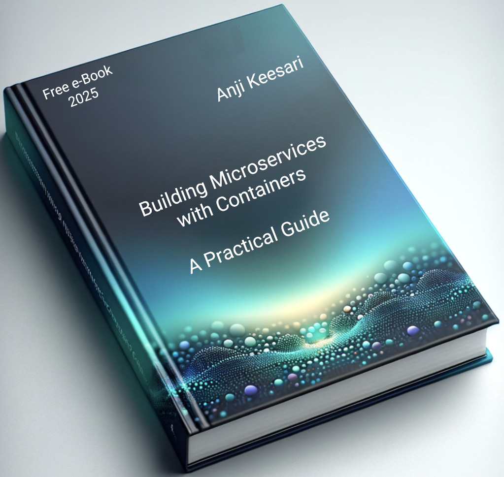
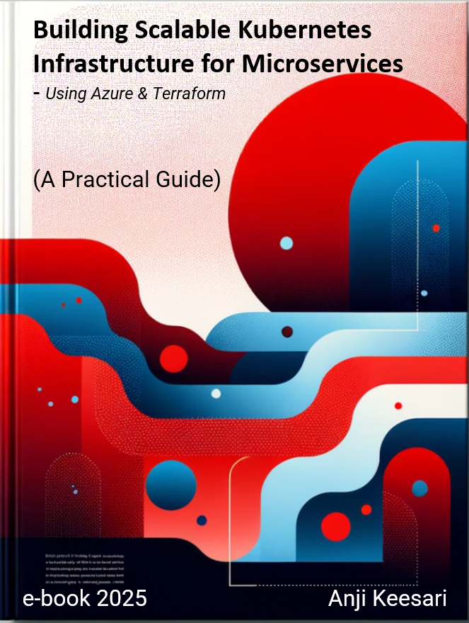

# Books

Two free e-books from hands-on experience with containers, Kubernetes and Azure. Read them online, chapter by chapter.

Free e-book

### [Building Microservices with Containers: A Practical Guide](microservices/index.md)

Creating microservices with Docker containers: .NET, Node.js and React apps, SQL Server and PostgreSQL databases, Keycloak and Drupal.

[Start reading](microservices/index.md){ .md-button .md-button--primary }

Free e-book In progress

### [Building Scalable Kubernetes Infrastructure for Microservices](kubernetes/index.md)

Building scalable Kubernetes infrastructure on Azure with Terraform: AKS, networking, ingress, certificates, Key Vault and monitoring. Chapters are added as they're written.

[Start reading](kubernetes/index.md){ .md-button .md-button--primary }

