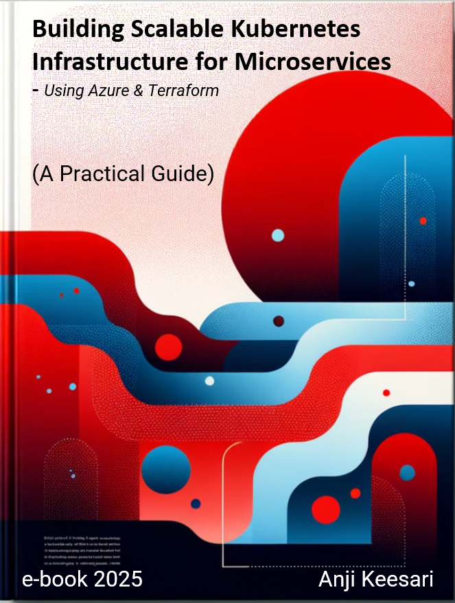

# Building Scalable Kubernetes Infrastructure for Microservices: A Practical Guide

Welcome to my eBook, **Building Scalable Kubernetes Infrastructure for Microservices (A Practical Guide)**.

In this book, I share my practical knowledge and hands-on experience in building scalable Kubernetes cloud infrastructure for microservices architecture using Azure and Terraform. I hope you find it valuable on your journey.

!!! note "Work in progress"
    This book is still a work in progress. You're welcome to read what has been written so far; chapters are added as they're written.

[Get started](gettingstarted/toc.md){ .md-button .md-button--primary }

{ width="400" }
