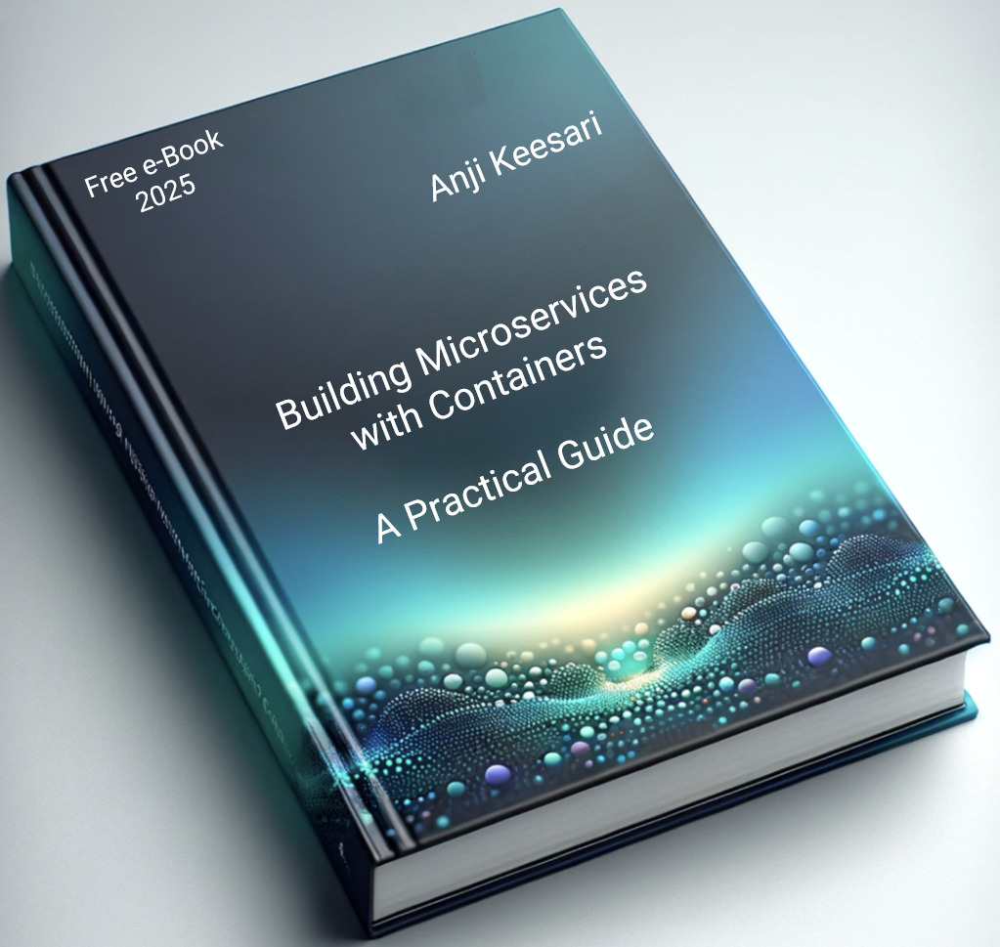

# Building Microservices with Containers: A Practical Guide

Welcome to my eBook, **Building Microservices with Containers: A Practical Guide**.

In this book, I share my practical knowledge and hands-on experience in creating microservices with docker containers. I hope you find it valuable on your journey.

[Get started](introduction/toc.md){ .md-button .md-button--primary }

Prefer to read offline? [Download the PDF](../../assets/Building%20Microservices%20with%20Containers%20(A%20Practical%20Guide).pdf){ target="_blank" }.

{ width="400" }
