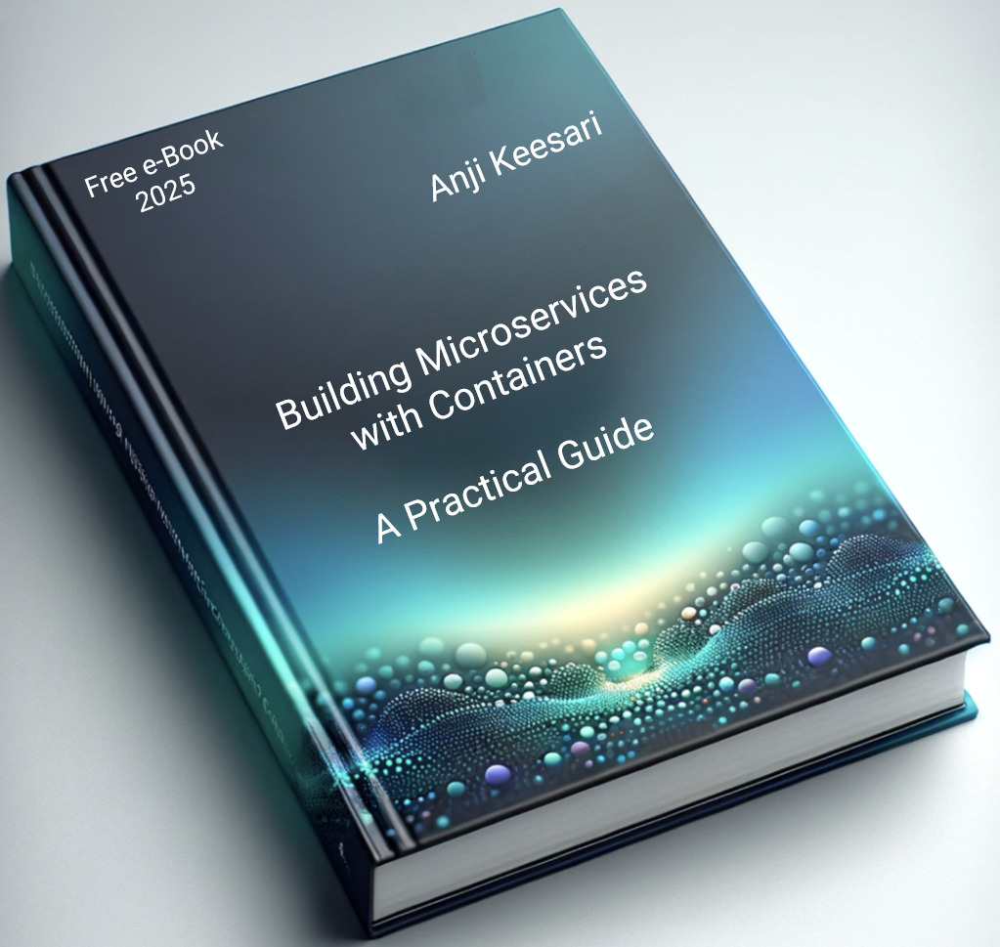

# Building Microservices with Containers: A Practical Guide

Welcome to my e-Book, `Building Microservices with Containers (A Practical Guide)`. In this book, I'm going to share my practical knowledge about creating  microservices with docker.

To delve into the complete contents of this e-Book, simply <a href="../../../assets/Building%20Microservices%20with%20Containers%20(A%20Practical%20Guide).pdf" target="_blank">download the PDF</a> or <a href="../../../books/microservices/">Read online</a> Free e-Book

<!-- [homepage](../../../). -->

Thank you for your interest, and happy reading!

